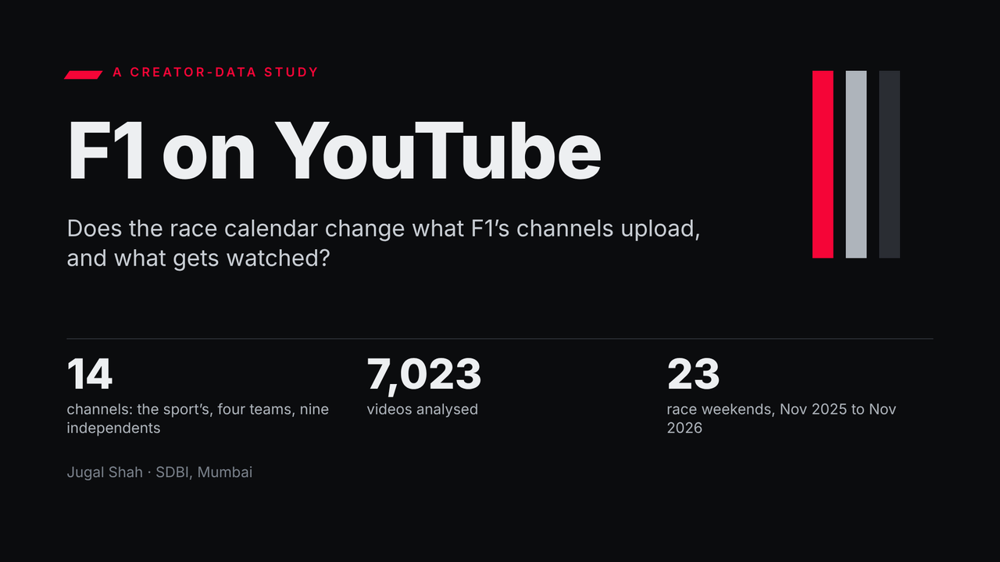

# F1 on YouTube: team channels, the sport's channel, and independent creators

A small data project on how Formula 1's YouTube ecosystem behaves across one season: 7,023 videos from 14 channels over 23 race weekends.

**Read it:** [report with the method, reasoning and limits](https://claude.ai/artifact/JSDQKHkRpBidrHhTZ9Yu6W) · [9-slide deck](https://claude.ai/artifact/TpkYQ9cp3QH9DeTAEQe6fU) · slide images in [`deck/preview/`](deck/preview)



**Questions**
1. How differently do the sport's own channel, the teams' channels and independent creators use YouTube (how often they post, in what format)?
2. Does the race calendar change what they post and how it performs?

**Scope:** YouTube only, public statistics only. The independent group is commentary and news creators. Two channels were pulled and then left out (see `data/excluded_channels.csv`): an F1 video-game channel, because its upload timing follows the game and not the race calendar, and a channel that posted only 14 videos in the whole window. Uploads from 2025-11-17 to 2026-11-09 (stats snapshot taken 2026-11-16).

## Findings

Seven findings. Every number is a formula in the workbook (`Summary` and `Analysis` sheets) and was re-computed independently in pandas.

1. **Everyone posts more around race day, the sport's channel most.** Uploads per channel per day on race weekends against ordinary days: the sport's channel 8.55 vs 2.53 (3.4×), teams 4.50 vs 2.02 (2.2×), independents 0.72 vs 0.45 (1.6×). The sport's channel peaks on Saturday and Sunday (9.6 and 9.1 a day). Independents peak the day *after* the race (1.24).

2. **Race weekends lift views for one kind of video: the sport's channel's highlight packages.** 114 videos (7.8% of the channel) bring in 31.5% of all its views and 59.4% of its Standard-video views. Their median is 3.3M views, against 332K for everything else it posts; Race Highlights alone has a median of 8.5M. Leave the packages out and race-weekend videos score 0.95× a normal video (1.42× with them).

3. **The post-race dip is a scheduling effect, not views fading.** Standard videos the sport's channel posts in the 3 days after a race score 0.56× normal. But 75 of those 161 videos are F2 "Chasing The Dream" (0.10×), podcasts (0.21×) and Jolyon Palmer's analysis show (0.54×), which score low in every window (0.10×, 0.24×, 0.59×). Everything else posted in those days scores 1.25×.

4. **Among independents, the lift is one channel.** Their race-weekend relative views are 1.20× as a group and 1.00× without Peter Windsor, who alone is at 3.16× (74 videos). His race-weekend videos with "analysis" in the title have a median of 60K views (59 videos), against 11K for his typical Standard video and 5.9K for the same kind of video posted in the 3 days after a race. The independents' median beat a normal video in 18 of 23 races, and in 13 of 23 without him. Others: TacticalRab 1.04×, Kym Illman 0.86×, Cameron Cc 0.60× (21 videos).

5. **Team views come from a few hits, mostly Shorts, and race weekends barely move them.** The top 10% of videos bring in 51% to 64% of a team's views, and Shorts 62% to 95%. Each team's biggest hit is personality or stunt content (198× a normal video for Red Bull, 118× Williams, 85× Mercedes, 83× McLaren). Teams' Standard videos score 1.06× on race weekends against 1.00× on ordinary days; their Shorts 1.02×.

6. **Several independents get far more views per subscriber than the big channels.** A typical video (median views) is 3.1% of subscribers for the sport's channel, 2.4% for Red Bull, 1.6% for McLaren, 3.2% for Williams and 7.8% for Mercedes. Among independents with at least 30 videos it is 115% for Formula Addict, 66% for TacticalRab, 30% for Cameron Cc, 17% for Tommo, 6.0% for Kym Illman and 5.5% for Peter Windsor. A typical TacticalRab video (102K subscribers, 67K views) out-draws a typical McLaren video (2.57M subscribers, 42K views). Above 100% is possible: a video can reach people who do not subscribe. Chain Bear (8 videos), Driver61 (20) and Racing Statistics (12) are too small to rank. Both formats are pooled, so a channel that mostly posts Shorts is compared on its Shorts.

7. **On team channels, videos naming the team's own drivers beat the rest.** Median relative views 1.41× for the 461 team-channel videos naming one of the team's two drivers (2026 line-ups), against 0.98× for the other 3,236. It holds on all four channels: Red Bull 1.36× vs 1.00× (82 videos), Mercedes 1.44× vs 0.83× (290), Williams 1.56× vs 1.00× (59) and McLaren 1.11× vs 1.00× (30, the weakest). On the sport's channel and the independents, videos naming the same eight drivers score 1.00× (536 videos), the same as their other videos. So the effect belongs to team channels, not to driver names in general.

These are associations over 23 race weekends, not causes. See Limits.

## Data

| Source | What | How |
|---|---|---|
| YouTube Data API v3 | Every upload by each channel: title, publish time, duration, views, likes, comments, live-stream flag; subscriber count | `yt_collect.py` |
| Jolpica F1 API (Ergast successor) | 2025 and 2026 race calendar: first practice day, race day, sprint weekend or not | `data/f1_calendar.csv` |

Channels are listed in `data/channels.csv` with a group: `f1_official`, `team` or `independent`.

## Method

1. **Collect** (`yt_collect.py`): for each channel, list every upload since the start date, then fetch each video's statistics.
2. **Clean** (`clean.py`): drop duplicates, live streams (a stream's views behave differently from an upload's), videos younger than 7 days (views still climbing), and videos with no duration. Every rule's effect is in `data/cleaning_log.csv`.
3. **Analyse** (`build_workbook.py` → `f1_youtube_study.xlsx`): every number on the Summary and Analysis sheets is an Excel formula over the Clean sheet. Clean also carries helper columns: the nearest race, days from race day, and a highlight-package flag.
4. **Check** (`verify_workbook.py`, `verify_analysis.py`): recompute the Summary, the helper columns and the Analysis sheet independently in pandas and compare.

**Definitions**
- *Short*: duration up to 60 seconds (the API has no Shorts flag, so this is a proxy). *Standard*: longer.
- *Race weekend*: uploaded between the first practice day and race day. *Post-race*: the 3 days after race day. *Other*: the rest. Dates are UTC.
- *Relative views*: a video's views divided by the median views of the same channel's videos in the same format uploaded in the same calendar month. Without the same-month comparison, race windows would look weaker than they are, because there are no races from December to February and those "ordinary" videos are older and have had longer to collect views.
- *Engagement rate*: (likes + comments) / views.
- *Highlight package*: a sport's-channel Standard video titled like "Race Highlights | 2026 Miami Grand Prix" (practice, qualifying, sprint or race, with the 2025 or 2026 season in the title; F2, F3 and Academy excluded). The rule is the formula in `Clean` column W.
- *Kinds of video* ("analysis", podcasts, "Chasing The Dream", Palmer analysis) are found by words in the title; the rules are the formulas on the `Analysis` sheet.

## Limits

- View counts are a snapshot and keep growing. Within a month, videos still differ in age by a few weeks, which matters most for the newest months.
- Team channels mix race content with promotion and brand videos. They are not separated here.
- Independent creators post rarely, so their figures rest on few videos. Cells based on fewer than 10 videos are greyed out in the workbook.
- Observational data over 23 race weekends: it shows what happened, not why.
- Many comparisons were run on one dataset, so a single gap (McLaren's 30 driver videos, say) should not be read on its own. Subscriber counts are as of the snapshot date.
- Highlight packages, the other kinds of video and driver names are found by title patterns and typed-in surnames, so a few videos may be mislabelled. The driver lists are the 2026 line-ups. A separate pandas script applies the same rules and gets the same counts.
- Group medians lean on busy channels, and three independents (Chain Bear, Driver61, Racing Statistics) have 20 videos or fewer.
- Shorts can now run up to 3 minutes, so some Shorts of 61 to 180 seconds count as Standard here.
- Instagram and Facebook are not covered; their public data cannot be collected through an official API.

## Run it yourself

```bash
pip install -r requirements.txt

# 1. get a YouTube Data API v3 key (Google Cloud Console), then:
export YOUTUBE_API_KEY="your-key"          # Windows cmd: set YOUTUBE_API_KEY=your-key
python yt_collect.py --since 2025-11-17    # writes data/raw_videos.csv

# 2. clean and build
python clean.py
python build_workbook.py                   # writes f1_youtube_study.xlsx
python verify_workbook.py                  # optional: cross-checks (need the workbook's cached values;
python verify_analysis.py                  # open and save it in Excel/LibreOffice first)
```

Never commit your API key. A full run uses a few hundred of the 10,000 free daily quota units.

## Files

```
yt_collect.py          collect uploads and statistics
clean.py               apply cleaning rules, add race-window columns
build_workbook.py      build the Excel workbook (formulas)
deck/build_deck.py     generate the 9 deck slides from the workbook's values (python deck/build_deck.py)
deck/check_geometry.py layout check for the generated slides
deck/preview/          PNG images of the 9 slides
verify_workbook.py     independent check of the Summary sheet
verify_analysis.py     independent check of the helper columns and the Analysis sheet
f1_youtube_study.xlsx  the workbook: Notes, Summary, Analysis, Clean, Baselines, Days, Calendar, Raw
data/                  channel lists, excluded channels, race calendar, raw pulls, cleaned data, cleaning log
```
